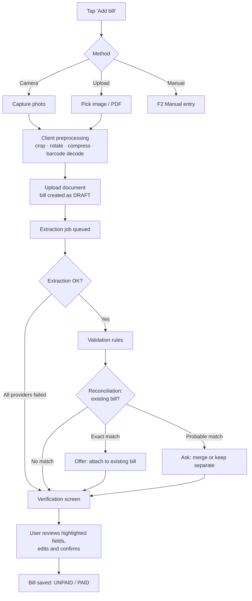

# 03 — User Flows & Screens

## 1. Key flows

### F1. Scan or upload → verify → save (the core flow)



**Rules**
- The user can leave the screen while extraction runs. A notification badge appears when it is ready.
- If the barcode identified the profile, it is pre-selected before extraction finishes.
- The bill stays in **Draft** until the user confirms it. Drafts never count in analytics.

### F2. Manual entry

1. Pick a **profile** (recently used profiles first; provider and type come from it), or tap **Quick expense**, which files it under "General expenses" (description + amount).
2. Required fields: amount, date (due or expense date). Everything else is optional, shown under "More details".
3. Option: **Already paid?** toggle → records a payment in the same step.
4. Save. The bill status comes from the payments.

Target: a one-off expense in **≤ 4 taps + typing**.

### F3. Record a payment

- From the bill detail page or a dashboard card: **Mark paid** (quick) or **Add payment** (full form).
- Partial payment → status *Partially Paid*, with the outstanding amount shown.
- Paid after the due date → the system shows "Late-fee amount applies: Rs X" and pre-fills that amount.

### F4. Duplicate detected

A scanned September LESCO bill is uploaded, and an official September bill already exists:

```
┌───────────────────────────────────────────────┐
│ This looks like a bill you already have        │
│                                               │
│  LESCO · 04 1234 5678 900 · September 2026    │
│  Existing: Official copy · Rs 8,420           │
│  New:      Scanned copy  · Rs 8,420           │
│                                               │
│  [ Attach to existing bill ]  (recommended)    │
│  [ Keep as separate bill ]                     │
└───────────────────────────────────────────────┘
```

### F5. Conflict review

```
┌───────────────────────────────────────────────┐
│ ⚠ Sources disagree on 1 field                  │
│                                               │
│ Payable within due date                       │
│   ○ Scanned copy      Rs 8,520   (conf. 71%)  │
│   ● Official source   Rs 8,420                │
│   ○ Enter manually    [________]              │
│                                               │
│   [ View documents side by side ]              │
│                         [ Resolve ]            │
└───────────────────────────────────────────────┘
```

### F6. Expected-bill reminder

The profile's bills typically arrive around the 10th. On the 13th there is still no bill for this cycle:
> 🔔 "Your September bill for **Home Electricity** (LESCO) hasn't been added yet."
> Actions: **Scan now** · **Upload** · **Fetch** (if retrieval is enabled) · **Skip this month**

### F7. First-run onboarding

1. Sign up, which creates the household and "My Home".
2. "What bills do you pay?" Tap the type chips (Electricity, Gas, Internet, Rent, Maintenance, …).
3. Each chip becomes a **profile** with a suggested name ("Home Electricity"), which the user can rename. For utilities: pick the provider and enter the reference number (or **scan a bill** to detect it).
4. Optional: add last month's bill so history starts right away.
5. Land on the dashboard, with the new profiles pinned.

### F8. Create a bill profile (any time)

1. **Profiles → ＋ New profile.**
2. Pick a **type** (or create a custom type). The **kind** comes from the type: metered, recurring or expense log.
3. Enter a **name** (required, unique). Choose an icon and colour.
4. Fill in the fields for the kind:
   - **Metered:** provider, reference no., meter no., unit.
   - **Recurring:** expected amount, cycle, due day, auto-create on/off.
   - **Expense log:** nothing else is needed.
5. Save. The new, empty profile dashboard opens with a prompt: "Add the first bill".

A user can repeat this for as many profiles as they like, e.g. "Home Electricity", "Shop Electricity" and "Upstairs Electricity" are three separate profiles of the same type.

---

## 2. Screen inventory

| # | Screen | Purpose | Key requirements |
|---|---|---|---|
| S1 | Sign in / Sign up | Auth | FR-AUTH-01…03 |
| S2 | Onboarding | Profiles set up in < 2 min | FR-ACCT-03 |
| S3 | **Dashboard** | Month at a glance | FR-DASH-* |
| S4 | Bills list | Filter, search, bulk actions | FR-SRCH-03/04 |
| S5 | **Bill detail** | Canonical record, sources, documents, payments, audit | FR-BILL-*, FR-RECO-06 |
| S6 | Add bill (method picker) | Scan / upload / manual | F1, F2 |
| S7 | Camera capture | Edge detection, crop | FR-EXTR-01/03 |
| S8 | **Verification** | Review extracted fields | FR-EXTR-08 |
| S9 | **Profiles** | All bill profiles, grouped by type; create, pin, reorder | FR-ACCT-08, 11 |
| S10 | **Profile dashboard** | One profile's own dashboard: Overview · Bills · Payments · Documents · Settings | FR-ACCT-10, FR-ANLT-01, FR-CONS-06 |
| S15 | Type overview | All profiles of one type, totalled and compared | FR-ACCT-12 |
| S16 | Create / edit profile | Name, type, kind-specific fields | FR-ACCT-03, 09 |
| S11 | Analytics | Category/provider breakdown, comparisons | FR-ANLT-* |
| S12 | Notifications | Inbox | FR-REM-* |
| S13 | Search results | Global search | FR-SRCH-01/02 |
| S14 | Settings | Household, members, categories, AI consent, export, delete | FR-ADM-*, FR-EXP-* |

**Navigation:** a bottom tab bar on mobile (Home · **Profiles** · **＋** · Analytics · More; the bills list and search sit under More) and a sidebar on desktop that also lists pinned profiles. The **＋** button is always one tap away. Opened from inside a profile, it pre-selects that profile.

---

## 3. Wireframes (low fidelity)

### S3 Dashboard (mobile)

```
┌──────────────────────────────┐
│ ◀  September 2026  ▶     🔔2 │
├──────────────────────────────┤
│ Total        Rs 18,450       │
│ Paid         Rs 12,300  ████▒│
│ Outstanding  Rs  6,150       │
├──────────────────────────────┤
│ ⚠ Overdue (0)   ⏰ Due soon(2) │
│ Electricity  Rs 8,420  Oct 08│
│ Water        Rs   900  Oct 11│
├──────────────────────────────┤
│ ❓ Not added yet              │
│ Internet (PTCL) — expected 05│
│          [Scan] [Upload]     │
├──────────────────────────────┤
│ Pinned profiles        All ›│
│ ┌────────┐┌────────┐┌───────┐│
│ │⚡ Home  ││🔥 Home  ││🌐 PTCL ││
│ │8,420   ││2,180   ││3,499  ││
│ │412 kWh ││86 hm³  ││       ││
│ │Unpaid  ││Paid ✓  ││Paid ✓ ││
│ └────────┘└────────┘└───────┘│
├──────────────────────────────┤
│ 🏠    ▦    ＋    📊    ⋯      │
└──────────────────────────────┘
```

### S9 Profiles (mobile)

```
┌──────────────────────────────┐
│ Profiles          [＋ New]    │
│ ( All )( Utilities )( Home )…│
├──────────────────────────────┤
│ ELECTRICITY            2 ›   │
│ ⚡ Home Electricity   Rs 8,420│
│    LESCO · Unpaid · Oct 08   │
│ ⚡ Shop Electricity   Rs 3,960│
│    LESCO · Paid ✓            │
├──────────────────────────────┤
│ RENT                   1 ›   │
│ 🏠 Flat Rent         Rs 40,000│
│    Recurring · due Oct 01 ✓  │
├──────────────────────────────┤
│ MAINTENANCE            1 ›   │
│ 🔧 Home Maintenance  Rs 5,700 │
│    3 entries in September    │
└──────────────────────────────┘
```
Tapping a type header (e.g. "ELECTRICITY 2 ›") opens the **type overview** (S15). Tapping a profile opens its **dashboard** (S10).

### S10 Profile dashboard: metered kind (mobile)

```
┌──────────────────────────────┐
│ ← ⚡ Home Electricity      ⋮  │
│    LESCO · 04 1234 5678 900  │
│ (Overview)(Bills)(Payments)… │
├──────────────────────────────┤
│▓▓▓▓▓▓▓▓▓▓▓▓▓▓▓▓▓▓▓▓▓▓▓▓▓▓▓▓▓▓│  ← dark featured card
│▓ September 2026     UNPAID  ▓│
│▓ Rs 8,420     due Oct 08    ▓│
│▓ 412 kWh · Rs 20.44/kWh     ▓│
│▓ [ Mark paid ]  [ View ]    ▓│
│▓▓▓▓▓▓▓▓▓▓▓▓▓▓▓▓▓▓▓▓▓▓▓▓▓▓▓▓▓▓│
├──────────────────────────────┤
│ This year   Avg/month  vs Aug│
│ Rs 68,310   Rs 7,590   +6.2% │
│                  (Rs 7,930→) │
├──────────────────────────────┤
│ Spend (12 months)            │
│ ▁▂▂▃▅▇█▇▅▃▂▃                 │
│ Units (12 months)            │
│ ▁▂▃▃▅▆█▇▅▄▃▄                 │
├──────────────────────────────┤
│ Recent bills          All ›  │
│ Sep  412 kWh  8,420  Unpaid  │
│ Aug  467 kWh  7,930  Paid ✓  │
│ Jul  421 kWh  7,140  Paid ✓  │
└──────────────────────────────┘
```

**Tabs**
- **Overview:** the widgets above (they change by kind; see [04](04-domain-model.md) BillProfile).
- **Bills:** the full records table, with filters and a range selector (month / quarter / year / custom).
- **Payments:** every payment for this profile, with receipts.
- **Documents:** every scan, PDF and receipt for this profile.
- **Settings:** name, icon, colour, provider/reference, meter, cycle, pin, archive.

### S10 Profile dashboard: expense-log kind (overview only)

```
┌──────────────────────────────┐
│ ← 🔧 Home Maintenance      ⋮  │
├──────────────────────────────┤
│ September    This year       │
│ Rs 5,700     Rs 41,200       │
├──────────────────────────────┤
│ By sub-category (this year)  │
│ Electrician ███████  18,400  │
│ Plumber     ████     11,300  │
│ Painting    ███       9,000  │
│ Other       █         2,500  │
├──────────────────────────────┤
│ Entries              [＋ Add] │
│ 28 Sep Electrician   3,500 ✓ │
│ 21 Sep Plumber       1,800 ✓ │
│ 05 Sep Tap washer      400 ✓ │
└──────────────────────────────┘
```

### S5 Bill detail

```
┌──────────────────────────────┐
│ ← Electricity · Sep 2026   ⋮ │
│ LESCO · 04 1234 5678 900     │
│ Status: UNPAID   Due 08 Oct  │
├──────────────────────────────┤
│ Payable by due date Rs 8,420 │
│ After due date      Rs 9,262 │
│ ├ Current charges   Rs 8,420 │
│ └ Arrears           Rs     0 │
│ [Line items ▾]               │
├──────────────────────────────┤
│ Meter  12,430 → 12,842       │
│ Units  412 kWh  (MF 1)  ✓    │
│ Rate   Rs 20.44 / kWh        │
├──────────────────────────────┤
│ Sources  ✓ Scanned ✓ Official│
│ Documents  📄 sep-2026.pdf    │
│            🖼 scan-0930.jpg   │
├──────────────────────────────┤
│ Payments   (none)            │
│        [ Mark as paid ]      │
├──────────────────────────────┤
│ History ▾  (audit log)       │
└──────────────────────────────┘
```

### S8 Verification (desktop: two columns; mobile: the document collapses to the top)

```
┌───────────────────────┬───────────────────────────┐
│                       │ Profile  [Home Electricity▾]│
│   [ bill image,       │ Period   [01 Sep–30 Sep]  │
│     zoom/pan,         │ Issue    [12 Sep 2026]    │
│     tapping a field   │ Due      [08 Oct 2026]    │
│     highlights its    │ Prev rd. [12430]          │
│     region ]          │ Curr rd. [12842]          │
│                       │ Units    [412]       ✓    │
│                       │ Payable  [8,520] ⚠ 71%    │
│                       │   ↳ doesn't match the sum │
│                       │     of line items (8,420) │
│                       │ After due[9,262]          │
├───────────────────────┴───────────────────────────┤
│  [ Discard ]                    [ Confirm & save ] │
└───────────────────────────────────────────────────┘
```

---

## 4. UX quality bar
- Optimistic UI for quick actions (mark paid). Skeleton loaders, not spinners.
- Every destructive action is undoable for 10 s (toast), or goes through the archive.
- Numbers are always right-aligned, with tabular figures and the currency formatted for the locale.
- Empty states teach the next action ("No bills yet — scan your first bill").
- Dark mode, and respect for reduced motion.
