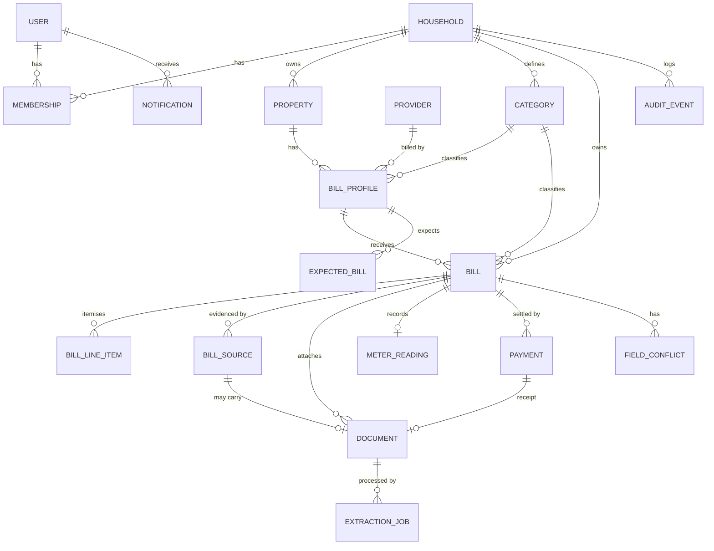
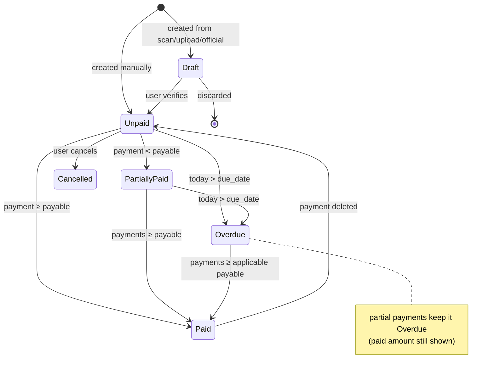
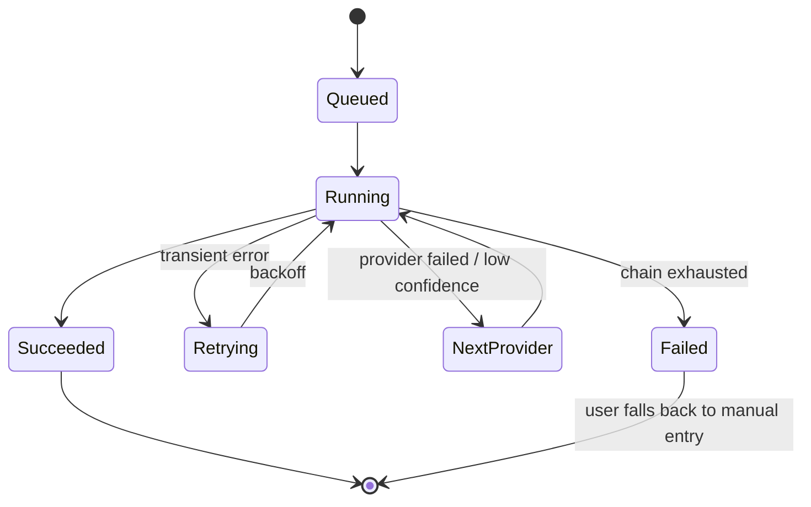

# 04 — Domain Model

Conventions:
- IDs are **UUIDv7** (time-ordered, safe to expose).
- Money uses `*_minor BIGINT` (paisa) + `currency CHAR(3)`. See [ADR-001](adr/001-money-as-integer-minor-units.md).
- Dates without a time (`DATE`) are used for billing concepts. Timestamps are `TIMESTAMPTZ` stored in UTC and displayed in the household timezone.
- Every table has `created_at` and `updated_at`. User-facing entities have `archived_at` (soft delete).
- **Every row is scoped to a `household_id`**, directly or through its parent. Authorisation is enforced on that key.

---

## 1. Entity-relationship overview



---

## 2. Entities

### User
| Field | Type | Notes |
|---|---|---|
| id | uuid | |
| email | citext unique | |
| password_hash | text null | argon2id; null when OAuth-only |
| display_name | text | |
| locale | text | `en-PK` default |
| email_verified_at | timestamptz null | |

### Household / Membership
- **Household:** `id, name, currency (PKR), timezone (Asia/Karachi), ai_extraction_consent (bool, default false), storage_used_bytes`
- **Membership:** `household_id, user_id, role (owner|editor|viewer)`. Primary key (household_id, user_id).

### Property
`id, household_id, name ("My Home"), address (text null), is_default (bool)`
Exactly one default per household.

### Category (bill type)
`id, household_id (null = system default), name, icon, color, default_kind (metered|recurring|expense_log), parent_id (null)`
System types are seeded (Electricity → metered, Rent → recurring, Maintenance → expense_log, …). Households can add custom types and hide system ones. `parent_id` allows sub-categories inside expense logs (e.g. Maintenance → Electrician, Plumber).

### Provider
| Field | Type | Notes |
|---|---|---|
| id | uuid | |
| household_id | uuid null | null = global catalogue; set = custom provider |
| name / short_name | text | "Lahore Electric Supply Co." / "LESCO" |
| default_category_id | uuid | |
| region | text null | |
| ref_number_pattern | text null | regex for validation |
| ref_number_label | text | "Reference No.", "Consumer ID", "Account No." |
| consumption_unit | text null | kWh, hm³, gallons |
| retrieval_connector | text null | connector key if supported (M6) |
| extraction_template | text null | parser key (M2) |

### BillProfile
A named, user-created tracker for one bill or expense stream. Users create as many as they need, including several of the same type. **Every bill belongs to exactly one profile, and every profile has its own dashboard.**

| Field | Type | Notes |
|---|---|---|
| id | uuid | |
| household_id, property_id | uuid | |
| category_id | uuid | the bill **type** |
| kind | enum | `metered` · `recurring` · `expense_log` (defaults from the type) |
| name | text | user-chosen, unique per household: "Home Electricity", "Shop Electricity", "Flat Rent" |
| icon / color | text | from the icon set and profile palette ([10](10-design-system.md) §2.4) |
| provider_id | uuid null | optional (an expense log usually has none) |
| reference_number | text null | normalised (digits only) for matching; display format kept separately |
| meter_number | text null | metered only |
| multiplying_factor | numeric(10,4) | metered only; default 1 |
| consumption_unit | text null | metered only; overrides the provider default |
| billing_cycle | enum null | monthly (default), bimonthly, quarterly, yearly; null for expense logs |
| typical_issue_day / typical_due_day | smallint null | learned from history if not set |
| expected_amount_minor | bigint null | recurring only (e.g. rent) |
| auto_create_bill | bool | recurring only: create the bill each cycle (FR-BILL-10) |
| is_default | bool | the "General expenses" profile of each property |
| pinned / sort_order | bool / int | shown on the home dashboard, in this order |
| retrieval_enabled | bool | default false (M6) |
| archived_at | timestamptz null | |

Unique: (household_id, lower(name)) and (household_id, provider_id, reference_number) where not archived.

**What each kind shows**

| Kind | Fields used | Profile dashboard widgets |
|---|---|---|
| `metered` | provider, reference no., meter, MF, unit, cycle | Latest bill, units, rate per unit, spend chart, consumption chart, readings history |
| `recurring` | provider (optional), expected amount, cycle, due day | Next due, paid streak, spend chart, price-change history |
| `expense_log` | none required | Entries list, spend by month, breakdown by sub-category |

### Bill (canonical record)
| Field | Type | Notes |
|---|---|---|
| id | uuid | |
| household_id | uuid | |
| bill_profile_id | uuid | **required**; quick one-off expenses go to the property's "General expenses" profile |
| category_id | uuid | defaults to the profile's type; in an expense log it can be a sub-category |
| description | text null | required for expense-log entries |
| bill_number | text null | invoice/bill no. when printed |
| period_start / period_end | date null | billing period |
| period_key | char(7) null | `YYYY-MM` of the billing month; part of the identity key |
| issue_date | date null | |
| due_date | date null | |
| expense_date | date | the date analytics use (= issue_date or the user-entered date) |
| current_charges_minor | bigint | charges for this period only |
| arrears_minor | bigint | default 0; previous unpaid balance carried over |
| adjustments_minor | bigint | default 0; credits/refunds (negative allowed) |
| payable_minor | bigint | payable within due date |
| payable_after_due_minor | bigint null | |
| currency | char(3) | |
| status | enum | see §3 |
| paid_minor | bigint | denormalised sum of payments |
| is_estimated | bool | estimated/average bill |
| verified_at / verified_by | | set when the user confirms the verification screen |
| field_meta | jsonb | per field: `{source, confidence, document_id}` |
| notes | text null | |
| tags | text[] | |
| archived_at | timestamptz null | |

**Identity key (dedup):** unique (bill_profile_id, period_key) where not archived, **for cycle-based profiles only** (kinds `metered`, `recurring`). Expense-log profiles allow many entries per month. Bill number is a secondary strong signal. See [06](06-reconciliation.md).

**Invariant (soft):** payable ≈ current_charges + arrears + adjustments. A mismatch raises a validation warning (FR-BILL-09), not an error, because providers round amounts.

### BillLineItem
`id, bill_id, label, kind (charge|tax|fee|adjustment|arrears|surcharge), amount_minor, sort_order`

### MeterReading
| Field | Type | Notes |
|---|---|---|
| bill_id | uuid PK/FK | one reading set per bill (MVP) |
| previous_reading / current_reading | numeric(14,3) | |
| register | text | `total` (default), `peak`, `offpeak` (TOU stores one row per register; PK becomes (bill_id, register)) |
| multiplying_factor | numeric(10,4) | snapshot of the profile MF when billed |
| printed_units | numeric(14,3) null | as printed on the bill |
| computed_units | numeric(14,3) | (curr − prev) × MF |
| reading_type | enum | actual, estimated, average |
| meter_replaced | bool | if true, previous_reading belongs to the new meter |

### BillSource
Each way this bill's data arrived.
`id, bill_id, kind (manual|scan|upload|official|email), document_id null, extracted_data jsonb, extractor (e.g. "gemini-flash", "ocrspace+lesco-template"), received_at, created_by`

### Document
| Field | Type | Notes |
|---|---|---|
| id | uuid | |
| household_id | uuid | |
| bill_id / payment_id | uuid null | the owner |
| kind | enum | bill_scan, bill_official, receipt, other |
| storage_key | text | object-storage key; never a public URL |
| mime_type, size_bytes, page_count | | |
| sha256 | char(64) | detects re-uploads of the same file |
| derived_key | text null | the compressed/normalised image used for OCR |
| ocr_text | text null | for full-text search |
| search_vector | tsvector | generated column |

### ExtractionJob
`id, document_id, status (see §3), attempts, provider_chain text[], current_provider, result jsonb, error text, started_at, finished_at`

### Payment
`id, bill_id, paid_on date, amount_minor, method (cash|bank_transfer|card|jazzcash|easypaisa|cheque|other), reference text null, notes, receipt_document_id null, created_by`

### FieldConflict
`id, bill_id, field, values jsonb ([{source_id, value}]), status (open|resolved), resolution (source_id | manual), resolved_value, resolved_by, resolved_at`

### ExpectedBill
Computed each day for each active profile with a billing cycle (kinds `metered`, `recurring`).
`bill_profile_id, period_key, expected_by date, state (pending|fulfilled|skipped|missed)`

### Notification
`id, user_id, household_id, kind (due_soon|due_today|overdue|expected_missing|retrieved|extraction_ready|conflict), bill_id null, bill_profile_id null, title, body, read_at, sent_channels text[], dedupe_key unique`

### AuditEvent
`id, household_id, actor_user_id null (null = system), entity_type, entity_id, action (create|update|archive|restore|delete|merge|resolve), changes jsonb ({field: [old, new]}), at timestamptz`
Append-only.

---

## 3. State machines

### Bill status



**Status derivation (single function, deterministic):**
```
if archived or cancelled            → Cancelled
if not verified and source ≠ manual → Draft
applicable = payable_after_due if (today > due_date and payable_after_due != null) else payable
if paid ≥ applicable                → Paid
if today > due_date                 → Overdue
if paid > 0                         → PartiallyPaid
else                                → Unpaid
```
A daily job re-derives status for bills whose `due_date` was yesterday. Payment writes re-derive it immediately.

Arrears rule: when bill *N+1* includes bill *N*'s unpaid amount as arrears, and the user then pays bill *N+1* in full, bill *N* is marked **Paid (settled via later bill)**. This happens automatically when bill *N+1*'s `arrears_minor` equals bill *N*'s outstanding amount; otherwise the user is prompted.

### ExtractionJob



---

## 4. Analytics definitions

| Metric | Definition |
|---|---|
| **Billed (spend)** | Σ `current_charges + adjustments` of verified, non-cancelled bills, plus late surcharges actually paid. **Arrears are excluded.** |
| **Cash paid** | Σ `payments.amount` in the range (by `paid_on`) |
| **Outstanding** | Σ (applicable payable − paid) over unpaid, partially paid and overdue bills that are *not* settled through a later bill's arrears |
| **Consumption** | Σ `computed_units` (or printed_units if no readings were captured) |
| **Effective rate** | billed ÷ consumption for the bill |
| **Date axis** | Billing period (`period_key`) by default; `expense_date` for expense-log entries |

---

## 5. Indexes (initial)
- `bill (household_id, period_key)`, `bill (household_id, due_date) where status in (unpaid, partially_paid, overdue)`
- `bill (bill_profile_id, period_key)` unique partial
- `bill (bill_profile_id, expense_date desc)` (profile dashboard records list)
- `bill_profile (household_id, pinned, sort_order)`
- `document (household_id, sha256)`
- `document using gin(search_vector)`
- `bill_profile (household_id, reference_number)`
- `notification (user_id, read_at)`
