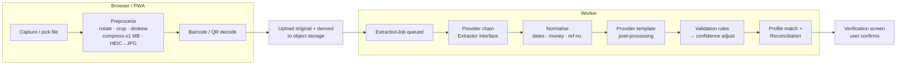

# 05 — Extraction Pipeline

How a photo or PDF becomes a verified, structured bill.

> **Accuracy principle:** high accuracy comes from **layering**: barcode identity, a good extractor, provider templates, deterministic validation, and finally **human verification**. No single OCR/AI API is trusted on its own.

---

## 1. Pipeline overview



## 2. Client-side preprocessing (free, private, fast)
- **Edge detection and perspective crop** of the paper (e.g. jscanify / OpenCV.js, or a simpler manual crop UI).
- Auto-rotate (EXIF), greyscale + contrast boost for OCR. Resize so the long edge is ≤ 2000 px, then JPEG quality ~0.8, aiming for ≤ 1 MB.
- **Barcode/QR decode** with the browser `BarcodeDetector` API, falling back to the ZXing JS library. Pakistani utility bills usually print the reference number as a barcode. This one step gives **provider + bill profile identity** with near-100% reliability.
- PDF: the first page is rendered for preview with pdf.js. Text-based PDFs (official copies) are text-extracted directly, so no OCR is needed.

## 3. Extractor interface

```text
interface Extractor {
  name() -> string
  supports(mime, pageCount, sizeBytes) -> bool
  requiresConsent() -> bool              // true for third-party AI
  extract(document, hints) -> ExtractionResult
}

hints = { providerId?, referenceNumber?, category?, locale }

ExtractionResult = {
  rawText?: string,
  fields: { <fieldName>: { value, confidence 0..1, bbox?: [page,x,y,w,h] } },
  lineItems: [{ label, amount, kind, confidence }],
  extractor: string, latencyMs: int, costUnits: int
}
```

**Target field schema:** `provider_name, reference_number, bill_number, customer_name*, billing_month, period_start, period_end, issue_date, due_date, previous_reading, current_reading, units, multiplying_factor, current_charges, arrears, payable_within_due, payable_after_due, line_items[]`
(*`customer_name` is used for matching only and is never stored. See [08](08-security-privacy.md).)

---

## 4. Extraction chain (final)

Every tier is **free with no payment card**. Tiers run in order. A later tier runs only when the earlier one fails or isn't confident enough (§4.2).

| Tier | Extractor | Where it runs | Free allowance (approx.) | Role |
|---|---|---|---|---|
| **0** | **Barcode/QR decode** + **PDF text layer** | Phone (barcode) / worker (PDF) | Unlimited | Instant, private identity (provider + reference no.). Text PDFs need no OCR at all |
| **1** | **Google Gemini Flash** (structured JSON output) | Google API | Free tier, rate-limited per minute and per day | **Primary.** Reads any layout and returns our field schema directly. Used only with household AI consent |
| **2** | **OCR.space** (Engine 2) → **provider template parser** | OCR.space API + our worker | ~25,000 requests/month, ≤ 1 MB per file | **Fallback**, and the default when there is no AI consent. Raw text is parsed by our templates |
| **3** | **Tesseract.js** (on-device OCR) → **provider template parser** | User's phone, in the PWA | Unlimited | **Offline/private fallback** (M5). Works with no internet; nothing leaves the phone |
| **4** | **Manual entry** with the document attached | — | — | Always available. **Re-run extraction** can be pressed later |

**Always after any tier:** normalisation → template cross-check → validation rules (§6) → **mandatory human verification**.

```
 Tier 0  barcode + PDF text ──────────────▶ identity (+ full text for text PDFs)
            │
            ▼
 AI consent? ── yes ──▶ Tier 1  Gemini Flash ──┐
            │                                   │ failed / low confidence
            no                                  ▼
            └─────────────────────────▶ Tier 2  OCR.space + templates
                                                │ failed / offline
                                                ▼
                                        Tier 3  Tesseract.js on device + templates
                                                │ failed
                                                ▼
                                        Tier 4  Manual entry (document kept)
            ▼
 Validation → Verification screen → Saved bill
```

### 4.1 Why this chain
- **Gemini first:** it is the most accurate free option on varied, photographed bills, and it returns structured fields without templates.
- **OCR.space second:** it is truly free and needs no card. It covers Gemini outages, quota limits and households without AI consent. Our templates turn its raw text into fields.
- **On-device last:** it is unlimited, private and works offline. It fits the PWA offline capture queue.
- **Our own layer is the real accuracy:** barcode identity + provider templates + validation + user corrections. Whichever OCR produced the text, the same layer checks it.

### 4.2 Fallback rules (when to move to the next tier)

| Trigger | Action |
|---|---|
| Timeout (> 20 s) or network error | Retry once with backoff, then the next tier |
| HTTP 429 / quota exhausted | Skip this tier until its quota resets (per-provider counter) |
| 3 consecutive 5xx errors | **Circuit breaker**: skip the tier for 15 min for all users |
| Invalid JSON / schema mismatch (Gemini) | One repair retry, then the next tier |
| Overall confidence < 0.6, or a critical field missing (payable, due date, reference no.) | Run the next tier and **merge field by field** (highest final confidence wins) |
| Every tier failed | The bill stays a Draft with the document attached. The user enters it manually and can **re-run extraction** later |

The user never waits on the chain. Tiers 1–2 run in the worker; tier 3 runs in the browser and posts its text to the API. The verification screen opens when extraction finishes.

### 4.3 Quotas
- Per-provider daily/monthly counters, so a tier is skipped *before* its free cap is hit.
- Per-household limit: 50 extractions/day (protects the shared free quotas).
- The same file (same sha256) reuses the earlier result.

## 5. Provider templates
For high-volume providers (LESCO and the other DISCOs that share the PITC bill format, K-Electric, SNGPL, SSGC, PTCL), a **template** holds:
- known labels and their synonyms ("Payable Within Due Date", "Amount Payable", "واجب الادا رقم"),
- the reference-number regex and checksum,
- expected sections (meter readings table, charges table),
- per-field post-processing rules (e.g. a "Bill Month" of "SEP 26" → `2026-09`).

Templates work in two ways:
- they **parse raw text** from OCR-only extractors, and
- they **cross-check** AI output (e.g. the AI's payable must appear in the raw text).

Templates are data (JSON/YAML), versioned, and each has its own test fixtures (sample bills with the expected output).

## 6. Validation rules (deterministic)

| Rule | Effect when violated |
|---|---|
| `payable ≈ current_charges + arrears + adjustments` (±Rs 1) | Flag the payable fields; confidence × 0.5 |
| `Σ line_items ≈ current_charges` | Flag line items |
| `(curr − prev) × MF ≈ printed_units` (±1) | Flag the readings |
| `curr ≥ prev` unless meter_replaced | Flag |
| `issue_date ≤ due_date`, due within 5–30 days of issue | Flag the dates |
| Billing month within ±2 months of the issue date | Flag |
| Amount is 0.2×–5× the profile's 6-month median | **Soft** warning ("unusually high") |
| Reference number matches the provider regex/checksum | Hard flag; blocks the auto-match |
| AI value doesn't appear in OCR raw text (when both exist) | Confidence × 0.6 |

The **final confidence** per field = extractor confidence × rule multipliers. Fields below **0.85** are highlighted on the verification screen, and fields below **0.5** are left empty to be typed in.

## 7. Learning loop
- Store `(extracted value, confirmed value)` pairs per field, extractor and provider.
- Dashboard (internal): accuracy per provider/extractor/field, which tells us which templates to improve.
- Repeated user corrections of a label mapping suggest a template update. This is reviewed by a developer, never automatic.

## 8. Prompt design for the AI extractor (summary)
- System prompt: "Extract only what is printed. If a field is not visible, return null. Never infer or compute amounts."
- Use a JSON schema / response schema enforced by the API (structured output).
- Provide hints: the provider (from the barcode), the expected field list, the date format.
- Temperature 0. One retry with an error-correction prompt if the JSON is invalid.
- Ask for a per-field `confidence` and the **verbatim source text** for money fields (used for cross-checking).

## 9. Upload limits
- Max 10 MB upload, 5 pages. The derived image is ≤ 1 MB (it fits OCR.space's free file limit).
- Extraction quotas: see §4.3.
