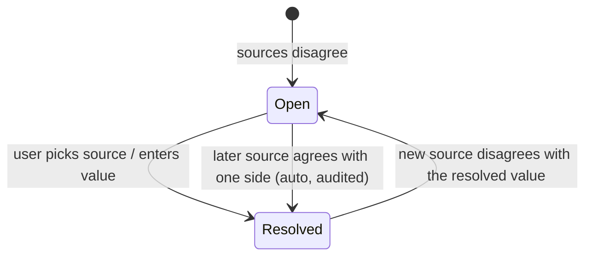

# 06 — Reconciliation & Deduplication

The same bill can arrive several times: scanned, uploaded as a PDF from WhatsApp, and retrieved from the official site. The system must keep **one canonical bill with many sources** and **never overwrite silently**.

```
September Electricity Bill (canonical)
├── Source: scan      (photo, extracted 30 Sep)
├── Source: official  (PDF, retrieved 01 Oct)
├── Field values      (each with provenance)
├── Conflicts         (open / resolved)
└── Audit history
```

---

## 1. Bill identity

| Signal | Strength | Notes |
|---|---|---|
| Same document `sha256` | Certain | Same file uploaded twice |
| `bill_profile_id` + `bill_number` | Very strong | When the provider prints a bill number |
| `bill_profile_id` + `period_key` | **Primary key** | One bill per profile per cycle, for cycle-based profiles (kinds `metered`, `recurring`; enforced by a unique index) |
| `reference_number` + `issue_date` ±3 days | Strong | When the profile is not yet linked |
| Provider + amount + due date | Weak | Only to *suggest* a match, never to auto-merge |

Entries in **expense-log** profiles (maintenance, repairs, general) can be many per month, so they are deduplicated only on `sha256`, or on profile + amount + date (suggestion only).

## 2. Matching algorithm

```text
on new candidate C (from any source):
  1. if document.sha256 exists → reuse the existing bill/result (no-op, tell the user)
  2. resolve profile: by reference_number → bill_profile (create on user confirm)
  3. exact = bill where profile = C.profile and (period_key = C.period_key
                                                 or bill_number = C.bill_number)
     if exact → ATTACH(C, exact)
  4. probable = bills of the same profile with |issue_date − C.issue_date| ≤ 10 days
                or the same payable and |due_date diff| ≤ 3 days
     if probable → ASK user (merge / keep separate)
  5. else → CREATE new bill from C
```

Weighted match scoring is not needed for the MVP. The rules above are deterministic and explainable, which matters for trust.

## 3. Attach / merge rules

When candidate **C** attaches to existing bill **B**:

For each field *f* in C:
| B has f? | Values equal?* | Action |
|---|---|---|
| No | — | Fill B.f from C (provenance = C's source) |
| Yes | Yes | Add C to the provenance (field now "confirmed by 2 sources") |
| Yes | No | **Create a FieldConflict(f)**. B.f is unchanged until the conflict is resolved |

\*Equality: money is exact (in minor units); dates are exact; readings allow ±0.5; text is normalised (case, whitespace, digits only for ref/bill numbers).

**Source precedence for display hints only (never an automatic overwrite):**
`user-edited > official > upload (text PDF) > scan`.
The UI pre-selects the highest-precedence value in the conflict dialog, but the user decides.

**Exception (configurable, off by default):** "Auto-accept official values when the conflicting field came from a low-confidence (< 0.5) scan *and* the bill is not yet verified." Even then, an audit event is written.

## 4. Conflict lifecycle



- A bill with open conflicts shows a ⚠ badge on its card and in the list. Its contribution to analytics uses the **current B.f value**, marked as "unverified".
- A dashboard tile lists "N bills need review".

## 5. Undo merge
Each ATTACH writes an `AuditEvent(action=merge)` with the full field snapshot. "Separate" restores B's previous values and re-creates C as its own bill (within 30 days; FR-RECO-07).

**As built (M6 phase 1):** tables `bill_sources` (kind, document, extraction, connector, the values given, fields it
filled, merged or original) and `bill_conflicts` (field, bill value, source value, open/resolved, resolution). Resolutions:
keep, source, manual, revised, and confirmed (automatic, when a later copy agrees with the bill). Undo = `POST
/bills/{id}/sources/{sourceId}/separate`; the detached document is re-saved from the scan screen rather than auto-creating a
bill, because a same-month bill can't exist twice in one profile. The auto-accept exception in §3 is not implemented.

## 6. Edge cases

| Case | Handling |
|---|---|
| Corrected/revised bill issued by the provider (same period, new amount) | Treat it as a conflict. The resolution offers "Provider revised the bill", which keeps the old value in history. |
| Two meters on one property (same provider) | Different reference numbers mean different profiles (e.g. "Home Electricity" and "Upstairs Electricity"), so no clash |
| Bi-monthly or quarterly cycle | `period_key` = the month the period *ends* |
| Bill covering arrears from several months | Arrears stays a single amount. The earlier bills get "settled via later bill" when paid (see [04](04-domain-model.md) §3) |
| Same bill scanned twice (different photos) | The step 3 exact match attaches the second scan as an extra source |
| Profile moved or renamed | Matching is on the normalised reference number, not the label |
