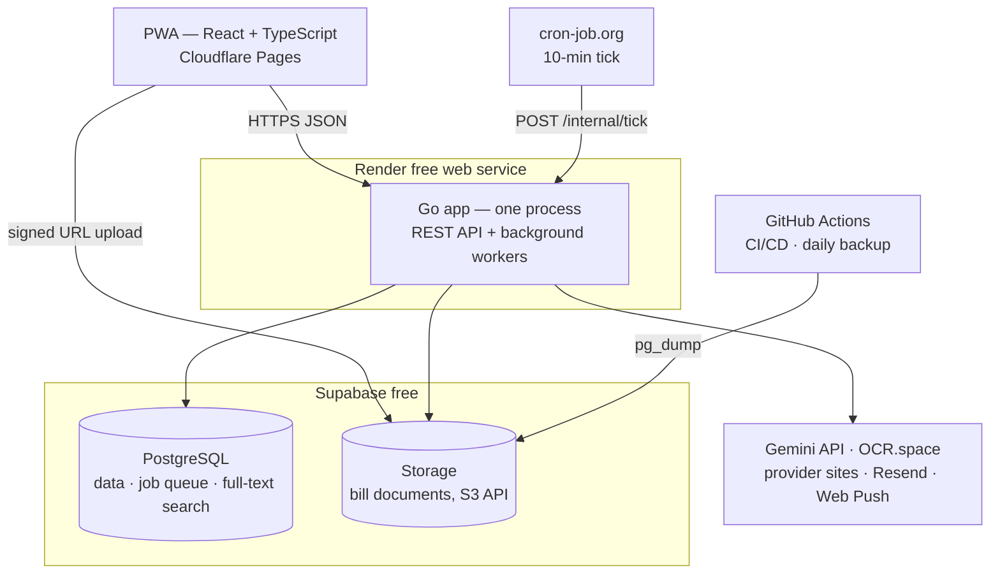

# 07 — Architecture

> **Final.** Go backend + React/TypeScript PWA, hosted entirely on free tiers that **need no payment card**, so the project can never be charged. Decisions: [ADR-003](adr/003-backend-language.md), [ADR-005](adr/005-hosting.md).

## 1. Constraints

| Constraint | How the architecture meets it |
|---|---|
| **Rs 0/month, no card** | Every service is a no-card free tier (§5) |
| **Production quality** | Typed Go + TypeScript, an OpenAPI contract, migrations, tests, CI, error tracking |
| **Strong processing** | Postgres-backed job queue with Go workers (goroutines) |
| **Polished, efficient UI** | React PWA: installable, offline-capable, mobile-first |
| **Mobile** | The PWA works on Android and iOS with the camera and push notifications |

## 2. System overview



## 3. Design decisions
- **Modular monolith.** One Go codebase with clear internal modules: auth, profiles, bills, extraction, reconciliation, payments, analytics, notifications, retrieval. Render's free tier runs one web service, so the **API and the job workers run in the same process** (`app serve`). The same binary can later run as separate `app api` / `app worker` processes without code changes.
- **Postgres is the job queue** (River, using `SKIP LOCKED`) **and the search engine** (`tsvector`). No Redis, RabbitMQ or Elasticsearch.
- **Direct-to-storage uploads** through presigned URLs, so large files never pass through the small API instance.
- **API contract first:** `api/openapi.yaml` generates the Go server interfaces (oapi-codegen) and the TypeScript client types.
- **External tick:** **cron-job.org** (free, no card) calls the authenticated `POST /internal/tick` every 10 minutes. (It is not run on GitHub Actions: the repo is private, and 4,300+ runs a month would exceed the 2,000 free minutes.) The tick runs due reminders, expected-bill checks and scheduled jobs. It also keeps the Render instance awake and stops Supabase pausing the project for inactivity.
- **Stateless app + standard Postgres + S3 API**, so moving to another host takes hours, not weeks.

## 4. Technology

### Backend — Go
| Concern | Choice |
|---|---|
| HTTP router | `chi` |
| Database driver | `pgx` |
| Queries | `sqlc` (type-safe Go generated from SQL) |
| Migrations | `goose` |
| Background jobs | `River` (Postgres-backed queue) |
| API contract | OpenAPI 3.1 + `oapi-codegen` |
| Auth | Own server-side sessions (HTTP-only cookies), argon2id, `golang.org/x/oauth2` for Google |
| Storage client | AWS SDK for Go v2 against Supabase's S3-compatible endpoint |
| Logging | `log/slog` (structured JSON) |
| Testing | `testing` + `testcontainers-go` (real Postgres) |

### Frontend — React + TypeScript PWA
| Concern | Choice |
|---|---|
| Build | Vite |
| Routing / server state | TanStack Router + TanStack Query |
| UI | Tailwind CSS + shadcn/ui (Radix primitives give accessibility), themed by the tokens in [10-design-system](10-design-system.md) |
| Fonts / icons | Red Hat Display via `@fontsource` (self-hosted, works offline); Lucide icons |
| Forms / validation | react-hook-form + zod |
| Charts | Recharts |
| PWA | vite-plugin-pwa (Workbox): offline shell, background-sync upload queue, Web Push |
| Scanning | Canvas preprocessing, `BarcodeDetector` with ZXing fallback, pdf.js previews, Tesseract.js (on-device OCR tier, M5) |
| i18n | i18next (RTL-ready for Urdu) |
| Tests | Vitest + Testing Library; Playwright end to end |

## 5. Hosting (all free, no card)

*Free-tier limits are approximate. Re-check them when creating the accounts.*

| Layer | Service | Free allowance (approx.) |
|---|---|---|
| Frontend | **Cloudflare Pages** | Unlimited static bandwidth, global CDN, preview deploys |
| API + workers | **Render** free web service | 512 MB RAM, 750 instance-hours/month (enough for one always-on service); sleeps after ~15 min idle |
| Database | **Supabase** Postgres | 500 MB |
| Document storage | **Supabase** Storage | 1 GB (about 1,000+ compressed bills) |
| CI/CD, daily backup | **GitHub Actions** | 2,000 min/month on private repos (CI + one backup run a day fits easily) |
| 10-minute tick | **cron-job.org** | Free scheduled HTTP calls, no card |
| Error tracking | **Sentry** | Free developer tier |
| Email (M5) | **Resend** | ~3,000 emails/month |
| Push (M5) | **Web Push (VAPID)** | Free, no vendor |
| OCR / extraction | **Gemini API** (Google AI Studio key) + **OCR.space** | See [05](05-extraction-pipeline.md) |

### Free-tier risks & mitigations
| Risk | Mitigation |
|---|---|
| Render instance sleeps, so the first request is slow | The 10-min tick keeps it awake. Go starts in under a second. The PWA shows cached data instantly |
| Supabase pauses a project after 7 days of inactivity | The tick queries the DB every 10 minutes |
| The tick service stops calling | cron-job.org emails on failures; `/healthz` reports the time of the last tick |
| Storage cap (1 GB files / 500 MB DB) | Client-side compression to ≤ 1 MB per image, a per-household quota, documents never stored in the DB |
| Data loss | Daily `pg_dump` via GitHub Actions + user export (FR-EXP-02) |
| A free tier changes | Standard Postgres + S3 API + a container image make moving straightforward |

## 6. Repository layout (monorepo)

```
/
├── docs/                    # this documentation
├── api/openapi.yaml         # API contract (source of truth)
├── backend/                 # Go modular monolith
│   ├── cmd/app/             # `app serve`, `app migrate`
│   ├── internal/<module>/   # auth, profiles, bills, extraction, reco, payments, ...
│   ├── queries/             # SQL for sqlc
│   └── migrations/          # goose
├── web/                     # React + TypeScript PWA
├── templates/providers/     # extraction templates + fixture bills
└── .github/workflows/       # CI, backup
```

## 7. Mobile
The PWA is the mobile app: installable from the browser, with camera capture, offline mode and push notifications on Android and on iOS 16.4+.
