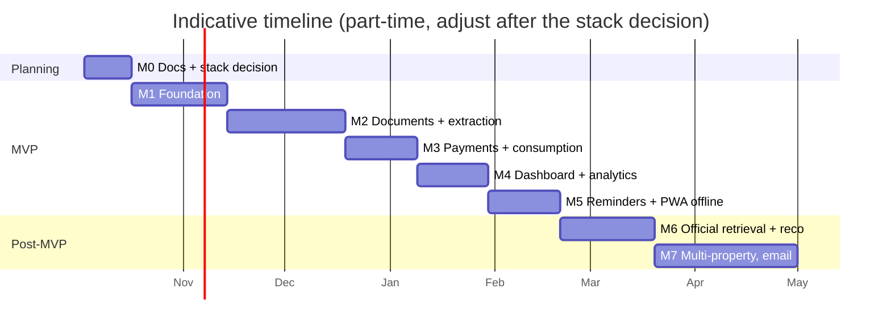

# 09 — Roadmap

Each milestone ends in something usable. **Exit criteria** must be met before the next milestone starts.

---

### M0 — Documentation & stack decision *(current)*
- All docs in `/docs` reviewed.
- ADR-003, 004, 005 **Accepted** ✓ (Go + React/TS PWA, OCR chain, no-card free hosting).
- Collect **10–20 real sample bills** (LESCO, SNGPL, PTCL, …) with personal data masked, as extraction test fixtures.
- **Exit:** sample-bill set ready; M1 implementation plan written.

### M1 — Foundation
- Monorepo, CI (lint, test, build), deploy pipeline to free tiers, environment and secret setup.
- Auth (email/password, sessions, reset), household + default property, members/roles.
- Provider seed catalogue, custom providers, **bill profiles** (unlimited, named, typed; three kinds), types, default "General expenses" profile.
- Manual bill and one-off expense CRUD, archive, audit log, status derivation.
- Design-system tokens and base components ([10](10-design-system.md)), light + dark.
- Base UI shell: navigation, Profiles screen, profile page with its records list, bill detail, settings.
- **Exit:** a user can sign up on the deployed URL, create bill profiles, add manual bills, and open each profile's page to see its records. Domain-logic test coverage ≥ 70%.

### M2 — Documents, extraction & verification
- Presigned upload, document storage, client preprocessing, barcode decode.
- Extraction job queue, Extractor interface, tiers 0–2 (barcode/PDF text, Gemini Flash, OCR.space + templates; per ADR-004), fallback rules, validation rules.
- Templates for at least LESCO/PITC-format bills, SNGPL and PTCL.
- Verification screen; profile matching; basic deduplication (FR-RECO-01…03).
- AI-consent setting, redaction.
- **Exit:** on the fixture set, ≥ 90% of fields correct before review; capture-to-saved < 30 s median; no duplicate is created when the same bill is uploaded twice.

### M3 — Payments, consumption & history
- Payments (partial, methods, receipts), quick "mark paid", late-fee logic, arrears settlement.
- Meter readings, MF, replacement, estimated flag.
- **Profile dashboards** (overview, bills, payments, documents): history table, spend chart, consumption chart; filters with URL state.
- **Exit:** a full month of real household bills can be tracked end to end.

### M4 — Dashboard, analytics & export
- Dashboard (FR-DASH-01…03, 05, 06), analytics with ranges, comparisons and the spend rule, global search, CSV export + full backup ZIP.
- **Exit:** answers every question in [01](01-product-vision.md) §3 from the UI; dashboard < 1 s.

### M5 — Reminders, expected bills & PWA *(MVP complete)*
- 10-minute tick (cron-job.org), due/overdue notifications, expected-bill detection, recurring templates.
- Installable PWA, offline shell, offline capture queue, on-device OCR tier (Tesseract.js), Web Push.
- **Exit:** used for real for one full billing cycle with no missed due dates. **MVP release.**

### M6 — Official retrieval & full reconciliation
- Connector framework (sandboxed, rate-limited, health-tracked); pilot connectors for 1–2 providers with public bill lookup.
- Field conflicts + resolution UI, source comparison, undo merge.
- **Exit:** a retrieved bill and a scanned bill of the same month merge into one record; when a connector is broken, nothing else is affected.

### M7 — Expansion
- Multi-property UI, email ingestion (forwarding address), email notifications, budgets.

---

## Definition of Done (every feature)
- Requirement IDs referenced in the PR.
- Unit and integration tests; end-to-end test for the main flows.
- Household-scoping test for any new endpoint.
- Audit events for mutations.
- Mobile and desktop UI checked; accessibility basics (labels, focus, contrast).
- Docs updated if behaviour changed.
